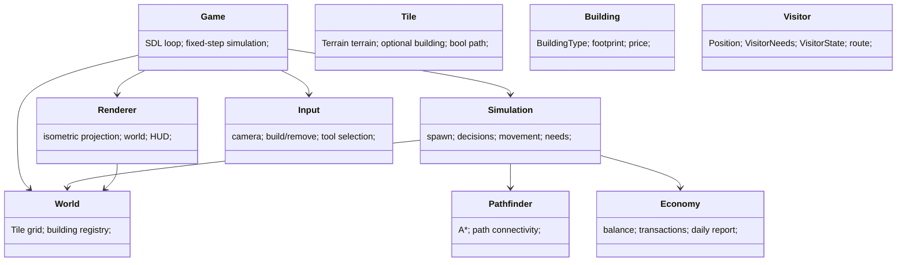

# Festival Grounds

A small, data-driven C++20 and SDL2 festival management sandbox. It uses a custom, lightweight entity/component-style model and a hand-drawn isometric renderer made from SDL geometry, so no external game engine or art assets are required.

## Build and run

Requirements: CMake 3.20+, a C++20 compiler, and an internet connection for the first configure if SDL2 is not already installed. CMake downloads and builds the official SDL2 2.32.8 source release as a static library when it cannot find an installed SDL2 package.

```sh
cmake -S . -B build
cmake --build build --config Release
./build/festival_grounds
```

On Windows, run `build\Release\festival_grounds.exe` for a multi-configuration generator.

### Windows scripts

1. Install CMake 3.20+ and Visual Studio Build Tools with the **Desktop development with C++** workload.
2. Double-click `start.bat` to configure, download/build SDL2 if needed, build the game, and launch it. To only configure the project, run `setup.ps1` in PowerShell; run `setup.ps1 -Build` to build without launching.

The scripts check for tools and report missing prerequisites. SDL2's source download requires internet access on the first configure.

## Controls

- **WASD / arrow keys:** scroll the camera; **Home:** recenter
- **1:** path, **2:** food stall, **3:** toilet, **4:** stage, **5:** entrance
- **Left click:** place selected item; **right click:** remove item / path
- **R:** rotate selected building; **Space:** pause; **N:** advance to next day
- **Escape:** quit

Start with the entrance and short path already built. Connect new paths to it, then place facilities beside paths. Visitors arrive automatically, use A* over connected path tiles, visit stages, buy food, use toilets, and leave as their needs change. The HUD shows balance, visitors, day phase, and selected tool. A daily report appears in the upper-right.

## Architecture



### Folder structure

```text
src/
  core/            # Shared types, constants, game orchestration (main.cpp currently owns loop)
  world/           # Tile grid and building placement
  entities/        # Visitor/building value types (kept header-only in core/Types.hpp)
  pathfinding/     # Grid A*
  simulation/      # Visitor needs, decisions, arrivals and day phases
  economy/         # Costs, transactions and daily summaries
  rendering/       # SDL isometric drawing and HUD
  ui/              # Mouse/keyboard commands and camera
data/              # Optional future building/visitor tuning data
assets/            # Optional future sprites/audio; current prototype is asset-free
```

### Runtime design

The SDL event loop handles input and rendering; simulation advances at a fixed 1/30-second step with an accumulator, independent of render cadence. Rendering is capped near 60 FPS. This gives deterministic-ish simulation steps and avoids tying visitor speed to display refresh. Hundreds of visitors use compact value records; A* is recalculated when a visitor gets a new target or the route is exhausted. Tile occupancy and building registries are the source of truth. Congestion can later be added as a movement cost in `Pathfinder` without changing visitor intent logic.

### Rendering and simulation notes

World coordinates project to screen using `sx=(x-y)*tileWidth/2`, `sy=(x+y)*tileHeight/2`; inverse projection maps clicks to tiles. Tiles and buildings are drawn in diagonal painter order. Camera offset supports keyboard scrolling. SDL filled polygons, lines, and circles stand in for bright, readable hand-drawn sprites.

Each visitor owns hunger, thirst, happiness, energy, and patience. A small state machine (`Entering`, `Wandering`, `GoingToStage`, `GoingToFood`, `GoingToToilet`, `Leaving`) scores nearby facilities against need thresholds, requests a connected A* route, and follows it tile by tile. Need decay, service outcomes, stage enjoyment, and exit satisfaction are independent per visitor. There are no authored visitor routes.

Placement checks map bounds, occupancy, affordability, and path adjacency for facilities. A preview is green when valid and red when invalid. Buildings are single-tile in this milestone; the footprint field is retained for future larger structures. Money changes only through the economy service, which also tracks daily revenue and expenses.

Future weather, staff, utility networks, artists, campaigns and multi-day events can be added as simulation systems consuming the same world, visitor, and economy interfaces. Building and visitor definitions are deliberately simple value data today; `data/` is reserved for JSON tuning and scenario files.
